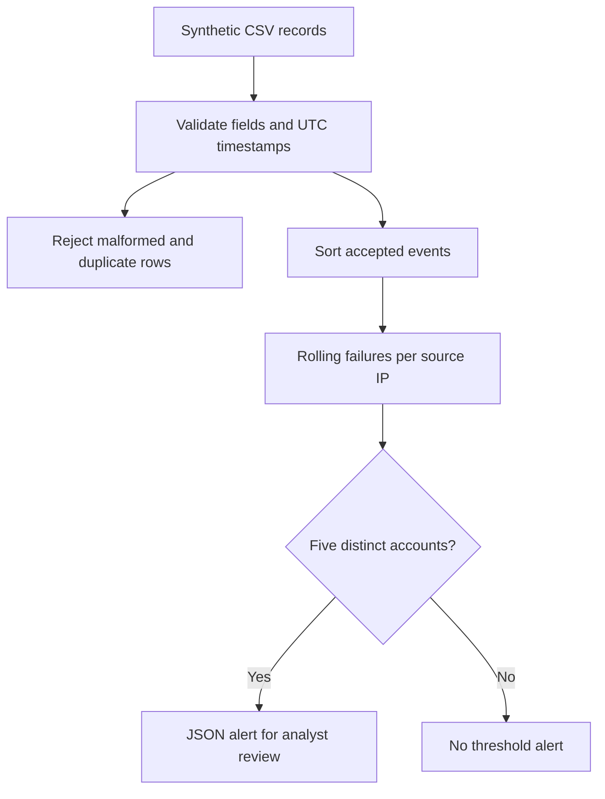

# SOC Password Spray Detection Lab

[](https://github.com/Banoth281/soc-password-spray-lab/actions/workflows/python-tests.yml)

**Santhosh Banoth | Offline authentication analysis and detection engineering**

Identify one source IP failing authentication against at least five distinct accounts within an inclusive five-minute window. Synthetic records only; the tool makes no login attempts.

## Recruiter overview

| Capability | Evidence |
|---|---|
| Multi-account correlation | [Detector](detect_spray.py) counts distinct accounts per source |
| Boundary and negative testing | [18 tests](test_detect_spray.py) covering detection, validation, and CLI behaviour |
| Reproducible findings | [Sample JSON](alerts.json) checked against regenerated output by a test |
| Analyst reasoning | [Investigation](investigation.md) separates evidence, alternative explanations, and proposed actions |
| Automated validation | [Windows and Linux workflow](.github/workflows/python-tests.yml) |

## Detection workflow



The records do not contain attempted passwords. A multi-account failure pattern is consistent with possible password spraying but does not prove that the same password was tried or that an account was compromised.

## Run

Python 3.10 or newer. Standard library only.

From this project folder:

```bash
python detect_spray.py
python -m unittest -v
```

On Windows, replace `python` with `py` if needed.

Optional settings:

```bash
python detect_spray.py --threshold 5 --window-minutes 5 --output alerts.json
```

Each run replaces the output report. The CLI refuses an output path that resolves to the input CSV. Invalid rows are excluded with physical CSV line numbers (the ending line for multiline rows); missing required columns or duplicate headers stop processing. Rows with missing or extra fields are rejected. Timestamps require timezone offsets and are normalised to UTC.

The CSV reader excludes exact normalised duplicates identified by timestamp, account, canonical source IP, and result. These are reported as rejected rows. Without event IDs, genuinely separate events with identical values cannot be distinguished and will be merged. Duplicate removal applies to CSV ingestion; callers of detect() must validate their own records.

## Sample result

12 valid events, no rejected rows, one alert:

| Source IP | Detected at (UTC) | Distinct accounts | Failed attempts |
|---|---|---:|---:|
| 198.51.100.25 | 2026-10-05 10:02:00 | 5 | 5 |

The report is a snapshot when the threshold is crossed. A sixth account fails later and Alice subsequently logs in successfully. Those later events are not appended to the alert snapshot; review the original records during triage. The success alone does not prove compromise.

## Detection behaviour

- Sort events by timestamp and correlate failures by source IP.
- Count distinct accounts, not just failed attempts.
- Include failures exactly five minutes old; exclude older failures.
- Emit one alert per source while its observed rolling count remains at or above the threshold.
- Allow another alert after the count falls below the threshold and crosses it again.
- Successful events do not count as failures and do not clear other accounts' failures.

## Files

| File | Purpose |
|---|---|
| `detect_spray.py` | Detector, validation and JSON reporting |
| `login_events.csv` | Synthetic authentication records |
| `alerts.json` | Reproducible sample output |
| `test_detect_spray.py` | 18 detection, validation, and CLI tests |
| `investigation.md` | Evidence, alternative explanations and proposed triage |

## Limitations

Shared proxies or gateways can produce benign multi-account failures. Distributed sources and attempts spaced beyond the window can evade this rule. No password, MFA, device, reputation or session data is supplied. Account names are compared exactly as written. This is an offline learning detector, not a production SIEM integration.

## Skills demonstrated

Authentication analysis, event correlation, input validation, Python automation, structured alert reporting, testing and evidence-based SOC triage.

## Audit and validation
The initial eight tests passed before modification. After the audit, all 18 tests passed locally and the sample JSON remained unchanged. See [audit notes](AUDIT.md) for changes, regression evidence, and limitations. Hosted workflow results are available through the badge above; no hosted pass is claimed until confirmed.
